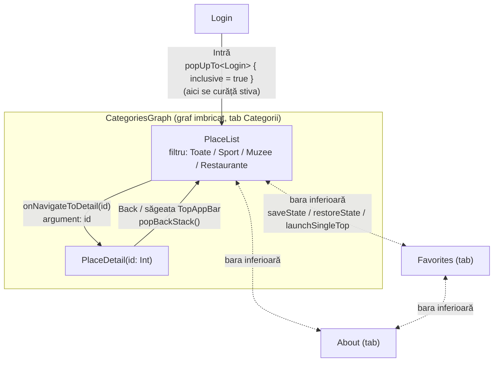

# Ghid Maramureș

Aplicație Android (Kotlin + Jetpack Compose) de tip ghid turistic, realizată pentru
**Calcul Mobil – Laboratorul 05**. Accentul este pe fluxul de navigare:
rute type-safe, argumente, back stack și ecrane decuplate de navigare.

Autor: Hojda Paul-Andrei

## Rulare

1. Clonați repository-ul și deschideți folderul în Android Studio.
2. Așteptați sincronizarea Gradle.
3. Rulați configurația `app` pe un emulator sau telefon (minSdk 24).
4. La Login, introduceți orice utilizator și parolă nevide.

## Tehnologii

- Kotlin, Jetpack Compose, Material 3
- Navigation Compose (Nav2) cu rute `@Serializable` (type-safe)
- `ViewModel` + `SavedStateHandle` pentru favorite

## Structura

```
data/        Place, Category, PlacesRepository (sursa unică de date), FavoritesViewModel
navigation/  Routes.kt (rutele), AppNavHost.kt (NavHost), BottomBar.kt
ui/screens/  Login, PlaceList, PlaceDetail, Favorites, About (fără NavController)
```

## Diagrama fluxului de navigare



| Tranziție | Rută / argument | Detalii |
|---|---|---|
| Login → Listă | `CategoriesGraph` | `popUpTo<Login> { inclusive = true }`: Back din listă închide aplicația |
| Listă → Detaliu | `PlaceDetail(id)` | se transmite doar `id`; detaliul citește restul din `PlacesRepository` cu `toRoute()` |
| Detaliu → Listă | `popBackStack()` | același comportament pentru Back de sistem și săgeata din TopAppBar; filtrul rămâne |
| Între tab-uri | `CategoriesGraph`, `Favorites`, `About` | `popUpTo<PlaceList> { saveState = true }`, `launchSingleTop = true`, `restoreState = true` |

## Decizii de arhitectură

- **Rute type-safe**: toate rutele sunt `object` / `data class` cu `@Serializable` (`Routes.kt`).
- **State hoisting**: ecranele primesc date și lambda-uri (`onNavigateToDetail: (Int) -> Unit`,
  `onBack: () -> Unit`); `NavController` apare doar în `AppNavHost` și `AppBottomBar`.
- **Filtrul** este ținut cu `rememberSaveable` în destinația `PlaceList`, deci se păstrează
  la deschiderea detaliului, la schimbarea tab-urilor (stare salvată prin `saveState`) și la rotire.
- **Tab-ul marcat** se determină cu `destination.hierarchy`, astfel încât în `PlaceDetail`
  rămâne marcat tab-ul Categorii.
- **Bara inferioară** este ascunsă pe ecranul de Login.

## Capturi de ecran

Vezi folderul [`screenshots/`](screenshots/).
